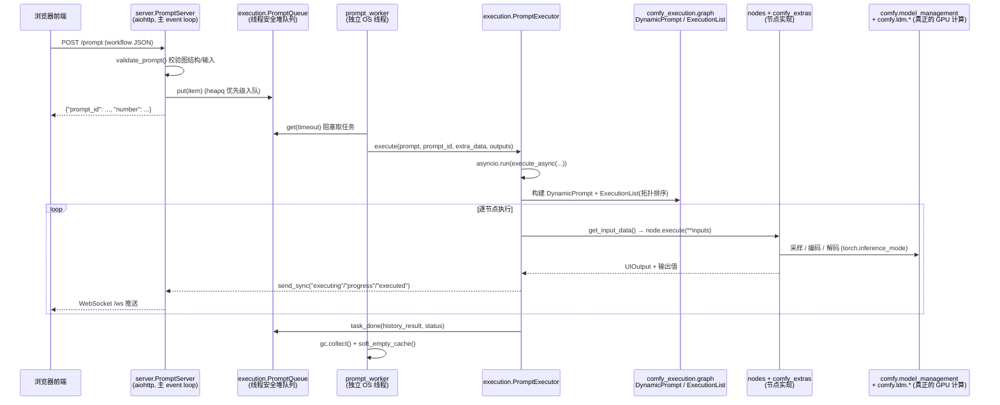

# ComfyUI v0.39.2 后端源码分析

> 基于 `comfyanonymous/ComfyUI` release `v0.39.2`（`pyproject.toml` 中 `version = "0.39.2"`，
> 与 `comfyui_version.py` 中的 `__version__` 一致）的后端源码整理。
> 本文只讨论**后端**（Python），前端是独立的 `comfyui-frontend-package` npm/pip 包。

---

## 一、项目入口与主要执行链路

### 1.1 唯一入口：`main.py`

ComfyUI 没有 `if __name__` 之外的启动器、没有 CLI 子命令框架、也没有 WSGI/ASGI 部署入口。
启动方式就是 `python main.py [参数]`，整个进程的生命周期都写在 `main.py` 里。

`main.py` 的执行顺序（模块顶层代码 + `__main__` 块）大致如下：

| 顺序 | 代码位置                                                                                     | 作用                                                                                                                                              |
| ---- | -------------------------------------------------------------------------------------------- | ------------------------------------------------------------------------------------------------------------------------------------------------- |
| 1    | `comfy.options.enable_args_parsing()` / `from comfy.cli_args import args`                | 解析命令行参数（`argparse`），全局单例 `args`                                                                                                 |
| 2    | `setup_logger(...)`                                                                        | 初始化日志系统（`app/logger.py`）                                                                                                               |
| 3    | `apply_custom_paths()`                                                                     | 处理`--base-directory`、`--models-directory`、`extra_model_paths.yaml` 等路径配置，落到 `folder_paths`                                    |
| 4    | `execute_prestartup_script()`                                                              | 扫描`custom_nodes/*/prestartup_script.py` 并执行（早于 torch 导入，供自定义节点做"打补丁"式准备）                                               |
| 5    | `import comfy.utils` / `execution` / `server` / `nodes` / `comfy.model_management` | **关键**：注释明确要求 torch 必须在这之后才被导入（`if 'torch' in sys.modules: logging.warning(...)`），避免自定义节点过早污染 torch 状态 |
| 6    | DynamicVRAM 初始化（`comfy_aimdo.control.init_devices`）                                   | 检测 GPU 能力，决定是否把`CoreModelPatcher` 换成 `ModelPatcherDynamic`                                                                        |
| 7    | `start_comfyui()`                                                                          | 真正的装配函数，见下                                                                                                                              |

`start_comfyui()`（`main.py:523`）是整个后端的"组装车间"：

```python
prompt_server = server.PromptServer(asyncio_loop, asset_manager)   # 建 aiohttp Application
hook_breaker_ac10a0.save_functions()                               # 保存关键函数指针
asyncio_loop.run_until_complete(nodes.init_extra_nodes(...))       # 注册内置节点 + 自定义节点
comfy.model_management.set_cudnn_benchmark()                       # 恢复 cuDNN 策略
hook_breaker_ac10a0.restore_functions()                            # 还原，防止自定义节点 hook
setup_database(asset_manager)                                      # SQLite + Alembic 迁移
prompt_server.add_routes()                                         # 挂载所有 HTTP/WS 路由
hijack_progress(prompt_server)                                     # 注入进度/预览回调
threading.Thread(target=prompt_worker, ...).start()                # 启动执行线程
return asyncio_loop, prompt_server, start_all                      # 交给调用者 run_until_complete
```

> `start_comfyui()` 返回 `(loop, server, start_all)` 三元组，是**有意的**：README 与代码注释
> 都说明"其他代码可以和 ComfyUI 的 event loop 与 server 集成"。嵌入式/二次开发场景
> （例如把 ComfyUI 塞进一个已有的 aiohttp 服务）可以直接复用这三个对象，而不必再走 `main.py`。

### 1.2 主要执行链路（一条 workflow 从提交到出图）



链路上的关键落点（可直接跳转阅读）：

1. **HTTP 接收**：`server.py:1080` `@routes.post("/prompt")`
   → `PromptServer.trigger_on_prompt()`（允许自定义节点拦截/改写）
   → `execution.validate_prompt()`（`execution.py:1138`）
   → `self.prompt_queue.put(...)`。
2. **队列**：`execution.py:1296` `class PromptQueue`。
   用 `threading.RLock` + `heapq` 实现，`get()` 会阻塞 worker 线程，`put()` 由 asyncio 线程调用。
   这是**asyncio 世界与同步执行线程之间唯一的交接点**。
3. **worker 线程**：`main.py:322` `prompt_worker()`。
   一个 `while True` 死循环，负责：取任务 → `PromptExecutor.execute()` → `task_done()` →
   按 flags 卸载模型 / `gc.collect()` / `soft_empty_cache()` / 暂停与恢复资产后台扫描。
4. **执行器**：`execution.py:663` `class PromptExecutor`，
   `execute()` 内部 `asyncio.run(self.execute_async(...))`（`execution.py:730`）—— 即**每个 prompt 起一个临时 event loop**，
   节点可以是 `async def`（v3 API），但整体仍跑在 worker 线程里，不占用 HTTP 线程。
5. **图与缓存**：`comfy_execution/graph.py`（`DynamicPrompt`、`ExecutionList`、拓扑/环检测）、
   `execution.py:113` `CacheType`（`CLASSIC` / `LRU` / `NONE` / `RAM_PRESSURE`，默认按 RAM 压力缓存，
   由 `--cache-*` 参数控制，见 `main.py:325`）。
6. **节点实现**：`nodes.py`（核心节点）+ `comfy_extras/nodes_*.py`（扩展节点）+
   `custom_nodes/`（第三方）+ `comfy_api_nodes/`（云端 partner 节点）。
7. **模型与显存**：`comfy/model_management.py`（设备/显存/卸载策略）、
   `comfy/model_patcher.py`（LoRA/ControlNet/条件注入的权重补丁）、
   `comfy/sample.py` + `comfy/samplers.py` + `comfy/k_diffusion/`（采样循环）、
   `comfy/ldm/*`（各模型族的网络结构）。
8. **回传**：`server.py:1400` `send_sync()` 把消息 `asyncio.run_coroutine_threadsafe` 回主 loop，
   再由 `send()`/`send_bytes()` 通过 `/ws` WebSocket 推给前端；
   图片预览走 `protocol.py` 的 `BinaryEventTypes` 二进制帧。

### 1.3 研究建议的阅读顺序

1. `main.py` → 看清装配顺序与线程模型；
2. `execution.py`（`PromptQueue` → `PromptExecutor.execute_async` → `get_input_data`）；
3. `comfy_execution/graph.py`（`DynamicPrompt` / `ExecutionList`）；
4. `nodes.py` 里挑一个最简单的节点（`EmptyLatentImage`、`KSampler`）跟到底；
5. `comfy/model_management.py` + `comfy/model_patcher.py`（ComfyUI 真正的核心竞争力）；
6. `server.py` 的路由部分（只当 API 手册看，不必逐行读）。

---

## 二、主要源码文件夹的作用

### 2.1 根目录的"骨架"文件

| 文件                         | 作用                                                                                    |
| ---------------------------- | --------------------------------------------------------------------------------------- |
| `main.py`                  | 进程入口、线程装配、DynamicVRAM 初始化                                                  |
| `execution.py`             | 图执行引擎：`PromptExecutor`、`PromptQueue`、`validate_prompt`、缓存类型          |
| `server.py`                | `PromptServer`：aiohttp app、全部 HTTP 路由、WebSocket 广播、静态资源                 |
| `nodes.py`                 | 核心节点定义 +`NODE_CLASS_MAPPINGS` 注册表 + 自定义节点加载器 `init_extra_nodes()`  |
| `folder_paths.py`          | 全局模型/输出/输入目录注册表`folder_names_and_paths`，路径解析与 containment 校验     |
| `protocol.py`              | 前后端二进制消息类型约定（`BinaryEventTypes`）                                        |
| `node_helpers.py`          | 节点侧通用辅助（条件拼接、mask 处理、`check_for_interrupt` 等）                       |
| `cuda_malloc.py`           | CUDA malloc 后端选择与黑名单显卡规避                                                    |
| `hook_breaker_ac10a0.py`   | 在导入自定义节点前后保存/还原被 hook 的关键函数（目前保护`model_management.cast_to`） |
| `latent_preview.py`        | 把 latent 粗略解码成预览图（无需 VAE）                                                  |
| `comfyui_version.py`       | 版本号，由构建流程从`pyproject.toml` 生成                                             |
| `manager_requirements.txt` | ComfyUI-Manager（可选组件）的独立依赖清单                                               |

### 2.2 `comfy/` —— 推理内核（最重的目录）

ComfyUI 的"引擎室"，与 HTTP/节点/UI 完全解耦，只关心 torch 张量与模型。

- **模型与显存**：`model_management.py`（设备、VRAM、卸载、`throw_exception_if_processing_interrupted`）、
  `memory_management.py`、`pinned_memory.py`、`system_memory.py`、`multigpu.py`、`model_prefetch.py`。
- **模型结构与加载**：`sd.py`（state-dict → 模型配置自动识别）、`model_detection.py`、
  `supported_models.py`、`model_base.py`、`model_patcher.py`、`model_sampling.py`、
  `ldm/`（各模型族实现：`flux`、`wan`、`qwen_image`、`hunyuan_video`、`cosmos`、`hidream`、
  `mochi`、`pixart`、`lumina`、`cascade`、`sam3`、`trellis2`、`audio` 等 40+ 子目录）、
  `cldm/`（ControlNet）、`extra_samplers/`、`taesd/`（轻量预览解码器）。
- **采样**：`sample.py`（KSampler 主循环）、`samplers.py`（各 scheduler/sampler）、
  `sampler_helpers.py`、`k_diffusion/`（外接采样器与扰动）。
- **条件与控制**：`conds.py`、`controlnet.py`、`gligen.py`、`hooks.py`（逐 step 权重钩子）、
  `context_windows.py`、`lora.py`、`weight_adapter/`。
- **文本编码**：`clip_model.py`、`sd1_clip.py`、`sdxl_clip.py`、`text_encoders/`（T5/UMT5/Gemma/
  Llama/Qwen/DeepSeek/… 及各 tokenizer 目录 + `clip_*.json` 配置）、`clip_vision.py`。
- **算子与数值**：`ops.py`（`ComfyAttention`、`cast_to_input` 等）、`quant_ops.py`（NVFP4/int8/w4a8）、
  `rmsnorm.py`、`float.py`、`nested_tensor.py`、`latent_formats.py`、`pixel_space_convert.py`。
- **其他模态**：`audio.py`、`audio_encoders/`、`image_encoders/`、`background_removal/`。
- **基础设施**：`cli_args.py`（全部命令行参数）、`options.py`、`deploy_environment.py`、
  `comfy_types/`（`Node`、`ComfyNodeABC`、`InputTypeOptions` 等类型契约）、`utils.py`、
  `internal_logging.py`、`storage.py`、`patcher_extension.py`。

### 2.3 `comfy_execution/` —— 执行引擎的辅助层

从 `execution.py` 里逐步抽出来的、与"节点调度"相关的通用件：

- `graph.py`：`DynamicPrompt`（支持运行时节点替换与 ephemeral 子节点）、`ExecutionList`（拓扑排序、
  依赖检查、subgraph 结果暂存）；
- `graph_utils.py`：`Graph`/`ExecutionBlocker`/`is_link`，自定义节点动态生成图时使用；
- `validation.py`：输入类型校验（`validate_inputs` 的 v3 侧实现）；
- `caching.py` / `cache_provider.py`：节点输出缓存的具体策略与 provider 接口；
- `progress.py`：进度状态与 handler（`WebUIProgressHandler` 在此注册）；
- `jobs.py`：job 生命周期与取消语义（`/prompt`、`/job` API 使用）；
- `asset_enrichment.py`：输出结果与资产系统的联动；
- `server_protocol.py` / `utils.py`：执行层与 server 的协议边界、`get_executing_context`。

### 2.4 `comfy_api/` 与 `comfy_api_nodes/`

- `comfy_api/`：**面向节点作者的公共类型与能力层**（版本化：`v0_0_1`、`v0_0_2`、`latest`）。
  `latest/_io.py`、`_input/`、`_ui.py`、`_caching.py` 提供声明式 `io.Combo`/`io.Int`/`io.ImageInput`
  与 `ComfyNode` v3 API；`feature_flags.py` 实现前后端能力协商（如 `supports_preview_metadata`）；
  `torch_helpers/`、`util/`、`generate_api_stubs.py` 生成 `**/generated/*.pyi` 存根。
- `comfy_api_nodes/`：**partner/云端节点**（OpenAI、Gemini、BFL、Runway、Kling、Luma、
  Stability、Topaz、Meshy、Tripo…）。这些节点通过 `aiohttp` 客户端访问外部 API，
  是**显式由用户主动发起**的网络调用，不属于 core 的联网路径（见 `AGENTS.md` 的 "No Internet Requests"）。

### 2.5 `comfy_extras/` —— 内置扩展节点

`nodes.py` 之外的官方节点集合，按模型/功能命名：`nodes_wan.py`、`nodes_flux.py`、
`nodes_qwen.py`、`nodes_hunyuan.py`、`nodes_video.py`、`nodes_audio.py`、`nodes_3d`（`nodes_load_3d.py`、
`nodes_save_3d.py`、`nodes_hunyuan3d.py`、`nodes_trellis2.py`）、`nodes_sam3.py`、`nodes_mediapipe.py`、
`nodes_glsl.py`、`nodes_controlnet.py`、`nodes_custom_sampler.py`、`nodes_logic.py`/`nodes_math.py`
（App Mode 的运算与流程控制）等。`nodes_replacements.py` 提供节点替换映射，
由 `init_builtin_extra_nodes()`（`nodes.py:2402`）逐个 import 并合并进 `NODE_CLASS_MAPPINGS`。

### 2.6 `app/` —— 应用服务层（有状态的产品功能）

- `assets/`：资产系统（`manager.py`、`scanner.py`、`seeder.py`、`api/`、`database/`、`services/`），
  基于 SQLite 索引 output 目录，提供哈希、去重、搜索、事件推送（`event_log.py`）；
  由 `--enable-assets` 开启，路由通过 `asset_manager.register_routes(app, user_manager)` 挂载。
- `database/`：SQLAlchemy + Alembic 的 DB 层（`db.py`、`models/`），迁移脚本在根目录 `alembic_db/`。
- `frontend_management.py`：从 `comfyui-frontend-package` 解析/初始化 web root，支持
  `--front-end-version` 与 embeds。
- `user_manager.py` / `model_manager.py` / `custom_node_manager.py` /
  `subgraph_manager.py` / `node_replace_manager.py`：按 `add_routes(routes, ...)` 的约定
  各自贡献一组 HTTP 端点（用户目录、模型浏览、自定义节点安装/禁用、子图、节点替换）。
- `app_settings.py`、`logger.py`：设置持久化与日志（含前端可查看的环形日志）。

### 2.7 `api_server/`、`middleware/`、`utils/`、`comfy_config/`

- `api_server/`：`routes/internal/internal_routes.py`（`/internal/*`，仅供官方前端使用，
  明确声明"不保证兼容"）、`services/terminal_service.py`（终端日志订阅）、`utils/`。
- `middleware/cache_middleware.py`：aiohttp 中间件，按扩展名给静态资源加 `Cache-Control`。
- `utils/`：`extra_config.py`（`extra_model_paths.yaml`）、`json_util.py`、`mime_types.py`、`install_util.py`。
- `comfy_config/`：`config_parser.py` + `types.py`，解析节点侧的 JSON/YAML 配置类型。

### 2.8 数据与内容目录

- `custom_nodes/`：第三方节点安装位置（默认只有 `example_node.py.example` 和
  `websocket_image_save.py` 两个样例）；加载逻辑在 `nodes.py:2254` `load_custom_node()`，
  支持 `__init__.py`、`nodes.py`、`*.py` 三种形态，并识别 `prestartup_script.py`、
  `WEB_DIRECTORY`、`NODE_CLASS_MAPPINGS`、`NODE_DISPLAY_NAME_MAPPINGS`、`IS_CHANGED`、
  `MUST_CALL_AFTER` 等约定。
- `models/`：`checkpoints/`、`clip/`(text_encoders)、`vae/`、`loras/`、`controlnet/`、`upscale_models/`、
  `diffusion_models/`、`vae_decode/` 等，注册表见 `folder_paths.py`。
- `input/`、`output/`、`user/`（默认在 `user/default/`，含 `comfyui.db`）、`temp/`。
- `blueprints/`：内置 workflow JSON 模板（前端 Gallery 数据源）。
- `script_examples/`：外部调用 ComfyUI HTTP API 的脚本样例。
- `tests/`（需要真实模型/权重的集成测试）与 `tests-unit/`（纯单元测试，独立
  `requirements.txt`，`pytest.ini` 指定 `testpaths = tests-unit tests`）。

---

## 三、为什么用 `requirements.txt` 而不是在 `pyproject.toml` 声明依赖

`pyproject.toml` 里确实**只有元数据和 lint 配置**，`[project]` 段没有 `dependencies`，
也没有 `[project.optional-dependencies]`。这是刻意的工程选择，原因可以归结为四点。

### 3.1 PyTorch 的安装本质上不是"一个包名"能表达的

`torch` 是同一个 PyPI 名字下的**多个互斥发行物**：CUDA 12.6 / CUDA 13.0 / ROCm / XPU / MPS /
CPU 版本 wheel 来自不同的 index URL。README 里针对不同硬件给出的安装命令是：

```
pip install torch torchvision torchaudio --extra-index-url https://download.pytorch.org/whl/cu130
pip install torch torchvision torchaudio --index-url  https://download.pytorch.org/whl/nightly/xpu
```

PEP 621 的 `dependencies` 数组**无法表达 `--index-url` / `--extra-index-url` / `--pre` /
`--find-links` 这类安装期指令**。若强行写进 `[project.dependencies]`，用户 `pip install .`
会拿到 PyPI 默认（通常是 CPU 版）的 torch，直接毁掉 ComfyUI 的核心价值。
`requirements.txt` 配合"先装 torch，再 `pip install -r requirements.txt`"的两步流程，
把后端选择权完整地留给用户，也让 Windows/macOS/Linux/ROCm/NPU 各平台能各自给出可复制的命令。

### 3.2 ComfyUI 不是"要发布的库"，而是"要 clone 下来跑的应用"

判断依据很明确：

- 没有 `[build-system]`，也没有 `[tool.setuptools]`/`[build-backend]`；
- 没有 `[project.scripts]` 入口点；
- `comfyui_version.py` 的注释写着"This file is automatically generated by the build process
  when version is updated in pyproject.toml" —— `pyproject.toml` 在这里的角色是
  **版本号的单一真源 + 工具配置载体**，不是分发清单；
- 官方分发形态是 GitHub Release、便携包（embedded python）、Desktop 应用，
  三者都直接读取 `requirements.txt`（或把它转成锁定的 site-packages）。

对应用类项目，`requirements.txt` 是"这个仓库在当前 commit 下需要且仅需要这些包"的
**可复现快照**，比 `pyproject.toml` + lockfile 的组合更直白、更容易被非 Python 用户理解，
也更容易被 Desktop/便携包构建脚本直接消费。

### 3.3 依赖分层与"非必需依赖"的表达

`requirements.txt` 中显式分了段：

```
#non essential dependencies:
kornia>=0.7.1
spandrel
pydantic~=2.0
pydantic-settings~=2.0
PyOpenGL>=3.1.8
comfy-angle
```

以及独立的 `manager_requirements.txt`（ComfyUI-Manager）。
这种"核心 + 可选 + 独立组件"的划分，靠 `requirements.txt` 的多文件与注释就能表达；
换成 `[project.optional-dependencies]` 反而要求所有安装路径（含便携包、Desktop、CI）
都改成 `pip install .[extras]` 形式，收益不明显、迁移风险大。
另外 `comfyui-frontend-package==1.53.10`、`comfy-kitchen==0.2.37`、`comfy-aimdo==0.5.5`
这类**精确 pin 的自有包**，用 `requirements.txt` 表达"这个 commit 配这个前端/内核版本"
最直接（`AGENTS.md` 甚至规定："一旦 `requirements.txt` 里 pin 了版本，就不要在代码里再写
兼容旧版本的分支"）。

### 3.4 生态兼容性与历史成本

ComfyUI 的绝大多数用户来自 Stable Diffusion 社区，习惯 `git pull` + `pip install -r requirements.txt`
这一套；无数第三方教程、启动脚本、Dockerfile、面板（如各种"一键包"）都硬编码了这条命令。
`AGENTS.md` 明确要求"Preserve existing APIs, node names, model-loading behavior, file layout,
and workflow compatibility"，安装方式同样属于这种兼容性契约。
同时 `tests-unit/requirements.txt` 让单元测试保持零 torch 依赖、秒级启动 —— 这也是多文件
`requirements` 结构带来的便利。

> **小结**：`pyproject.toml` 负责"项目身份 + 工具链配置（ruff / pylint / requires-python）"，
> `requirements.txt` 负责"运行期依赖 + 平台化安装语义"。二者分工而非替代。

---

## 四、为什么直接用 aiohttp 而不是 FastAPI / Starlette / Flask

`server.py` 里 `self.app = web.Application(client_max_size=..., middlewares=middlewares)`
是标准的 aiohttp 用法；`add_routes()` 用 `web.RouteTableDef` 声明式注册；
WebSocket 用 `web.WebSocketResponse`；静态资源用 `web.static`；
`/internal/*` 通过 `app.add_subapp()` 挂子应用。整个后端**只有一个 aiohttp**，
没有 ASGI、没有 Uvicorn、没有 WSGI 适配层。这个选择对 ComfyUI 而言是正确的，理由如下。

### 4.1 需求本身非常窄：一个"单机本地服务"，不是 Web 应用

ComfyUI 后端的真实需求清单：

1. 少量 JSON REST 端点（`/prompt`、`/queue`、`/history`、`/view`、`/upload/*`、`/models`…）；
2. 一个 WebSocket（`/ws`）做单向推送（进度、预览图、执行状态、队列变化）；
3. 静态文件服务（前端 bundle、模板、内嵌文档、`/extensions/*`）；
4. 二进制流（预览图帧，`protocol.py` 的 `BinaryEventTypes`）；
5. 大文件上传（`--max-upload-size`）。

不需要：认证/授权体系、OpenAPI/Swagger、表单与会话、ORM 集成、依赖注入容器、
ASGI 中间件生态、多进程 WSGI 部署。
FastAPI 的核心卖点（Pydantic 校验 + 自动文档 + DI）在这里几乎用不上——
ComfyUI 的输入校验是**节点图级别的自定义逻辑**（`execution.validate_inputs`、
`comfy_execution/validation.py`），不是 HTTP JSON schema 校验；
它的"schema"是 `INPUT_TYPES`/`RETURN_TYPES` 这套自有协议，由前端 `getTree` 消费。
用 FastAPI 反而要把自己的校验体系架在 Pydantic 之上，做无用功。

### 4.2 线程模型：aiohttp 让"asyncio 网络层 + 同步计算线程"边界最清晰

这是最关键的一点。ComfyUI 的计算**不能跑在 event loop 里**：

- 一次采样可能持续几分钟到几小时；
- torch 的 CUDA kernel、`model_management` 的显存卸载、`gc.collect()`、`soft_empty_cache()`
  都是阻塞调用；
- 大量第三方自定义节点是纯同步代码，不会 `await`。

ComfyUI 的方案是：**主 event loop 只做 I/O，计算跑在独立线程**（`main.py:564`
`threading.Thread(target=prompt_worker, daemon=True, ...)`），
两者通过 `PromptQueue`（`threading.RLock` + `Condition`）和
`send_sync()`（`asyncio.run_coroutine_threadsafe`）通信。

在这个模型下，框架需要提供的能力恰好是 aiohttp 的原生强项：

- 原生 asyncio server（无 WSGI 桥接、无 thread pool 猜测）；
- 原生 WebSocket 且能持有长连接字典（`self.sockets` / `self.sockets_metadata`）；
- 从同步线程安全回投协程（`run_coroutine_threadsafe`）；
- 二进制帧与 multipart 上传（`client_max_size`）。

FastAPI/Starlette 走 ASGI，虽然底层也可以是 uvloop，但它把"同步依赖"交给
`run_in_threadpool`（AnyIO worker 池）管理，而 ComfyUI **明确不想让执行落在 Web 框架的线程池里**
——它需要一个自己完全掌控的、单实例的、带 GC 与模型卸载策略的常驻 worker 线程。
用 FastAPI 只会多出一层"框架线程池 vs 我的 worker 线程"的心智负担。

Flask 是同步 WSGI，做 WebSocket 需要引入 `flask-sock`/`gevent`/事件循环适配，
静态文件与异步上传都要额外拼装，反而更复杂。

### 4.3 依赖最小化与"零框架锁定"

`AGENTS.md` 的工程风格写着："Prefer fewer dependencies. Do not add new dependencies to ComfyUI
unless they are absolutely necessary."（`requirements.txt` 里也确实没有 uvicorn、starlette、
fastapi、pydantic 之外的 Web 相关包；`pydantic` 只作为 non-essential 存在，用于部分 API 节点）。

- `aiohttp` 已经因为**其他用途**必须在依赖里：`comfy_api_nodes/util/client.py`、
  `upload_helpers.py`、`download_helpers.py` 等 partner 节点要用 `ClientSession` 发起 HTTP 请求，
  `PromptServer.setup()` 也自建了一个 `aiohttp.ClientSession`。
- 既然 `aiohttp` 已经在依赖树里，用它同时承担 server 就是"零新增依赖"；
  引入 FastAPI 会连带 starlette + pydantic v2 + anyio + uvicorn/h11 等一串。

同时，aiohttp 的 API 面很小（`Application` / `RouteTableDef` / `middleware` / `WebSocketResponse`），
ComfyUI 的自定义节点生态**不需要也不应该**依赖 Web 框架的类型系统；
节点作者只需要理解 `INPUT_TYPES`/`RETURN_TYPES`，与 HTTP 层完全隔离。
用 FastAPI 会把 Pydantic 模型、`Depends`、`response_model` 等概念泄漏进项目边界，
增加与 `comfy_api` v3 声明式 API 的概念冲突。

### 4.4 前端是一体化交付的，不需要 REST 生态

ComfyUI 前端（`comfyui-frontend-package`）和后端是**同一团队、同一发布节奏、同一进程交付**的
（`server.py` 直接 `web.static('/', self.web_root)` 把前端挂成根路径）。
不存在"第三方客户端要靠 OpenAPI 文档对接"的场景；对外 API 契约写在 `openapi.yaml` 里
作为文档而非代码生成源。
在这种"私有协议 + 单客户端"的设定下，FastAPI 的自动文档/生态优势完全用不上，
而它的运行时开销（每次请求的 Pydantic 校验、依赖解析）反而是纯负担——
`/prompt` 提交的是包含成百上千节点的 workflow JSON，校验逻辑必须是自定义的
（`validate_prompt` 需要检查图结构、环路、类型兼容、缓存有效性），
用 Pydantic 表达不了，还得多解析一遍。

### 4.5 历史与体量因素

ComfyUI 从 2023 年初（Stable Diffusion WebUI 生态之外独立起家）就用 aiohttp，
`server.py` 已经增长到 ~1500 行、承载了 WebSocket、静态资源、CORS、origin-only 中间件、
`--offline` 阻断中间件、Manager 中间件、子应用、`/api` 前缀双挂载（方便前端 dev server 代理）
等定制行为。这些定制全部基于 aiohttp 的原语，迁移到 ASGI 生态是一次收益极低、
风险极高的重写。`AGENTS.md` 的"Change the least amount of files possible"同样适用于架构决策。

> **一句话总结**：ComfyUI 需要的是"一个能同时提供 REST + WebSocket + 静态文件 + 二进制流、
> 且能与自己掌控的同步计算线程干净协作的极简 asyncio HTTP 库"。
> aiohttp 正好是这个描述的最短路径；FastAPI/Starlette/Flask 解决的是 ComfyUI 没有的问题，
> 并且会引入 ComfyUI 不想要的依赖与心智模型。

---

## 五、"节点"与"连线"在底层代码中的表示

> 本章回答两个问题：**节点被抽象成什么**、**连线被抽象成什么**。
> 一句话预告结论：ComfyUI 后端**没有 Edge 对象**，连线是"嵌在输入槽里的一个二元数组"；
> 节点则有两套并行的抽象规范（V1 类属性约定 / V3 声明式 `Schema`），
> 最终由 `Schema.get_v1_info()` 归一化，让执行引擎只面对一种接口。

### 5.1 先看"线上格式"：一张图就是一个嵌套 dict

前端 `POST /prompt` 提交的 `prompt` 字段（`server.py:1097`）就是后端的图数据结构。
它是**以 node_id 为键的字典**，每个 value 描述一个节点：

```python
# 后端看到的 workflow（prompt / graph dict）
{
  "1": {                                   # ← node_id：字符串键，后端只当不透明 ID
    "class_type": "CheckpointLoaderSimple",
    "inputs": {
      "ckpt_name": "v1-5-pruned-emaonly.safetensors"   # ← 常量（widget 值）
    }
  },
  "4": {
    "class_type": "CLIPTextEncode",
    "inputs": {
      "text": "a cat",
      "clip": ["1", 1]                     # ← 连线！[上游 node_id, 上游输出槽序号]
    },
    "_meta": { "title": "CLIP Text Encode (Prompt)" }   # 可选，仅用于错误提示
  },
  "7": {
    "class_type": "KSampler",
    "inputs": {
      "seed": 1234,                        # 常量
      "model":      ["1", 0],              # 连线 → 节点1 的第 0 个输出
      "positive":   ["4", 0],              # 连线 → 节点4 的第 0 个输出
      "negative":   ["5", 0],
      "latent_image": ["6", 0]
    }
  }
}
```

**关键观察**：

- 图里**没有** `links` 数组、没有 `edges`、没有邻接表。
  前端 workflow JSON 里的 `nodes[].inputs[].link`（一个整数 link id）和顶层 `links` 列表
  **只存在于前端**；提交给后端时已被"解引用"成 `[node_id, output_index]` 形式。
  后端全文搜索 `"links"` 键找不到任何消费点。
- 连线是**输入槽的属性**，而不是独立的图元素。一条边 = "某个节点的某个输入名，
  其取值写成 `[源节点ID, 源槽序号]`"。
- 因此图天然**有向**（从上游指向下游），且**同一对节点之间可以有多条线**
  （不同输入名或不同源槽），无需任何去重逻辑。
- 输出侧没有"被谁连接"的信息 —— 下游关系是后端在调度时**反向推导**出来的（见 5.4）。

#### 5.1.1 连线的唯一判定函数：`is_link`

`comfy_execution/graph_utils.py:1`

```python
def is_link(obj):
    if not isinstance(obj, list):   return False
    if len(obj) != 2:               return False
    if not isinstance(obj[0], str): return False
    if not isinstance(obj[1], int) and not isinstance(obj[1], float): return False
    return True
```

这就是"连线"的**全部规范**：长度为 2 的 list，`[0]` 是 str 节点 ID，`[1]` 是数字槽序号。
整个代码库（校验、取数、缓存签名、子图展开、循环检测）都靠这一个鸭子类型判断来区分
"这是一条线" vs "这是一个常量值"。

> **由此产生的一个真实约束**：任何 widget 的值如果是**长度为 2 的 list 且首元素是字符串**，
> 就会被误判成连线。所以后端在校验时对"list 型 widget 值"做了显式包装约定 ——
> `execution.py:993`：值写成 `{"__value__": [...]}`，校验时再解包回 `inputs[x]`。
> 这是"用类型歧义换极简结构"的典型代价点。

#### 5.1.2 连线的构造端：`GraphBuilder` / `Node`

动态生成子图（节点展开、App Mode、循环体）时不手写 dict，而用
`comfy_execution/graph_utils.py` 的 `GraphBuilder` + `Node`：

| 成员                                                             | 作用                                                                       |
| ---------------------------------------------------------------- | -------------------------------------------------------------------------- |
| `GraphBuilder.node(class_type, id=None, **kwargs)` → `Node` | 建节点；`id` 省略则自增 `id_gen`，并自动加 `prefix`（防 ID 冲突）    |
| `Node.out(index)` → `[self.id, index]`                      | **产出连线对象**，直接赋给下游节点的输入名即可                       |
| `Node.set_input(key, value)` / `get_input(key)`              | `value=None` 时删除该输入（等价于"断开这条线"）                          |
| `Node.serialize()`                                             | →`{"class_type", "inputs", ["override_display_id"]}`，即 5.1 的线上格式 |
| `GraphBuilder.finalize()`                                      | 所有节点 serialize 成 graph dict                                           |
| `GraphBuilder.replace_node_output(node_id, index, new_value)`  | 全图扫描，把指向`node_id[index]` 的所有线替换或删除                      |
| `add_graph_prefix(graph, outputs, prefix)`                     | 子图嵌套时重写 node_id**以及内部所有连线两端**，保证 ID 全局唯一     |

典型用法（`custom_nodes/example_node.py.example` 与各类展开节点的模式）：

```python
gb = GraphBuilder()
loader = gb.node("CheckpointLoaderSimple", ckpt_name="x.safetensors")
encode = gb.node("CLIPTextEncode", text="hi", clip=loader.out(1))  # ← 用 .out() 连线
return {"expand": gb.finalize()}, encode.out(0)                     # ← 输出也是连线形式
```

注意最后一行：**节点的返回值也可以是连线**（`["4", 0]`），
执行引擎在 `execution.py:598` 用 `is_link(node_outputs[i])` 识别它，
并把它转成 `add_strong_link(...)` 加入调度图。

---

### 5.2 节点的抽象表示

后端存在**两代节点规范**，共存且互操作：

|          | V1（经典类属性约定）                                         | V3（声明式 Schema）                                                                |
| -------- | ------------------------------------------------------------ | ---------------------------------------------------------------------------------- |
| 定义位置 | `nodes.py`、`comfy_extras/*`、多数自定义节点             | `comfy_api/latest/_io.py`、新节点                                                |
| 基类     | `ComfyNodeABC`（`comfy/comfy_types/node_typing.py:214`） | `io.ComfyNode`（`_io.py:2451`）→ `_ComfyNodeBaseInternal`                   |
| 输入声明 | `INPUT_TYPES()` 返回嵌套 dict                              | `define_schema()` 返回 `io.Schema(inputs=[io.Int.Input(...), ...])`            |
| 输出声明 | `RETURN_TYPES` / `RETURN_NAMES` 元组                     | `io.Schema(outputs=[io.Image.Output(), ...])`                                    |
| 执行入口 | `FUNCTION = "sample"` 指向实例方法                         | 固定`execute()` 类方法（`FUNCTION` 自动映射为 `EXECUTE_NORMALIZED[_ASYNC]`） |
| 实例化   | `class_def()` 建对象并按 node_id 缓存                      | 同样`class_def()`，但语义上是类方法容器                                          |
| 判定     | `issubclass(class_def, _ComfyNodeInternal)` 为 False       | 为 True（`execution.py:164` 的 `is_v3`）                                       |

**归一化机制**是这套双轨制能共存的原因：`Schema.get_v1_info(cls)`（`_io.py`）把 V3 声明
翻译成 `NodeInfoV1` dataclass，再由 `INPUT_TYPES`/`RETURN_TYPES`/`FUNCTION` 等
`@classproperty` 暴露成 V1 形状。于是 `execution.py` 里几乎不需要区分两代，
只在 hidden 注入、动态输入 finalize、`validate_inputs` 函数名等少数处分叉。

#### 5.2.1 V1 节点规范：属性与方法清单

**类型契约**（`comfy/comfy_types/node_typing.py`）：

```python
class ComfyNodeABC(ABC):
    @classmethod
    @abstractmethod
    def INPUT_TYPES(s) -> InputTypeDict: ...   # 唯一强制项
```

`InputTypeDict = {"required": dict[str, (IO, InputTypeOptions)],                   "optional": dict[str, (IO, InputTypeOptions)],                   "hidden":   HiddenInputTypeDict}`

**重要类属性**（执行引擎/前端会读取的）：

| 属性                                                                          | 类型                | 谁在读                                                                             | 语义                                                     |
| ----------------------------------------------------------------------------- | ------------------- | ---------------------------------------------------------------------------------- | -------------------------------------------------------- |
| `INPUT_TYPES`                                                               | classmethod         | `get_input_info`、`get_input_data`、`/object_info`                           | 输入名 →`(类型, 选项)`                                |
| `RETURN_TYPES`                                                              | `tuple[IO,...]`   | **连线类型校验**（`validate_inputs`）、`is_link` 目标槽合法性            | 输出槽的类型，**元组下标即槽序号**                 |
| `RETURN_NAMES`                                                              | `tuple[str,...]`  | 前端                                                                               | 输出槽显示名                                             |
| `OUTPUT_TOOLTIPS`                                                           | `tuple[str,...]`  | 前端                                                                               | 输出槽 tooltip                                           |
| `FUNCTION`                                                                  | `str`             | `get_output_data` → `obj.FUNCTION`                                            | 执行方法名（字符串，非可调用）                           |
| `OUTPUT_NODE`                                                               | `bool`            | `validate_prompt`（决定哪些节点是执行根）、`ux_friendly_pick_node`（优先调度） | 是否是输出节点；**没连到输出节点的子图不会被执行** |
| `HAS_INTERMEDIATE_OUTPUT`                                                   | `bool`            | `execution.py:432` `_is_intermediate_output`                                   | UI 结果跨刷新保留，但不自动加入执行列表                  |
| `INPUT_IS_LIST`                                                             | `bool`            | `_async_map_node_over_list`                                                      | 输入整体收成`list[type]` 一次处理                      |
| `OUTPUT_IS_LIST`                                                            | `tuple[bool,...]` | `merge_result_data`（`execution.py:330`）                                      | 哪些输出是"列表需展开成多次下游执行"                     |
| `NOT_IDEMPOTENT`                                                            | `bool`            | `CacheKeySetInputSignature.get_immediate_node_signature`                         | 相同输入也不许复用缓存，node_id 进缓存签名               |
| `CATEGORY` / `DESCRIPTION` / `SEARCH_ALIASES` / `ESSENTIALS_CATEGORY` | str/list            | `/object_info` → 前端菜单与搜索                                                 | 纯展示                                                   |
| `EXPERIMENTAL` / `DEPRECATED` / `DEV_ONLY` / `API_NODE`               | bool                | 前端标记                                                                           | 纯展示/分组                                              |
| `RELATIVE_PYTHON_MODULE`                                                    | str                 | 由`load_custom_node` 写入                                                        | 记录来源模块                                             |

**可选方法**（存在即被调用）：

| 方法                                         | 调用点                                        | 语义                                                                         |
| -------------------------------------------- | --------------------------------------------- | ---------------------------------------------------------------------------- |
| `IS_CHANGED(**inputs)`                     | `IsChangedCache.get`（`execution.py:64`） | 返回指纹值；变了就重跑。V3 里叫`fingerprint_inputs`                        |
| `VALIDATE_INPUTS(...)`                     | `validate_inputs`（`execution.py:846`）   | 自定义校验，返回`True`/`False`/错误字符串；支持 `input_types` 特殊参数 |
| `check_lazy_status(**kwargs)`              | `execution.py:511`                          | 返回"还需要求值的输入名列表"；配合`{"lazy": True}` 实现惰性/分支求值       |
| `map_node_over_list(...)`                  | `_async_map_node_over_list`                 | 自定义列表广播行为                                                           |
| `CheckLazyMixin`（`node_typing.py:324`） | —                                            | 提供"要求全部输入"的默认`check_lazy_status`                                |

**注册表**：`nodes.NODE_CLASS_MAPPINGS: dict[str, type]`（`nodes.py:2076`）+
`NODE_DISPLAY_NAME_MAPPINGS`。`class_type` 字符串就是这张表的键，
执行时 `nodes.NODE_CLASS_MAPPINGS[class_type]` 是唯一解析路径。
加载入口 `nodes.init_extra_nodes()`（`nodes.py:2583`）：
内置核心 → `init_builtin_extra_nodes()`（`nodes.py:2402`）→
`init_external_custom_nodes()`（`nodes.py:2352`，走 `load_custom_node`，`nodes.py:2254`）→
`init_builtin_api_nodes()`。自定义节点模块必须提供 `NODE_CLASS_MAPPINGS`（V1）
**或** `comfy_entrypoint()` 返回 `ComfyExtension`（V3），二者皆无则跳过并告警。

**一个真实 V1 节点**（`nodes.py:1605` `KSampler`，节选）：

```python
class KSampler:
    @classmethod
    def INPUT_TYPES(s):
        return {"required": {
            "model": ("MODEL", {"tooltip": "..."}),
            "seed": ("INT", {"default": 0, "min": 0, "max": 0xffffffffffffffff,
                              "control_after_generate": True}),
            "sampler_name": (comfy.samplers.KSampler.SAMPLERS, {}),   # 旧式 list == Combo
            "positive": ("CONDITIONING", {}), "negative": ("CONDITIONING", {}),
            "latent_image": ("LATENT", {}), "denoise": ("FLOAT", {"default": 1.0, "min": 0.0, "max": 1.0}),
        }}
    RETURN_TYPES = ("LATENT",)          # 1 个输出，槽 0 类型 LATENT
    OUTPUT_TOOLTIPS = ("The denoised latent.",)
    FUNCTION = "sample"                 # 执行 s.sample(...)
    CATEGORY = "model/sampling"
    DESCRIPTION = "..."
    SEARCH_ALIASES = ["sampler", "txt2img", ...]

    def sample(self, model, seed, steps, cfg, ...):
        return common_ksampler(...)     # 返回 tuple，长度须 == len(RETURN_TYPES)
```

#### 5.2.2 V3 节点规范：`Schema` / `Input` / `Output` / `NodeOutput`

**`Schema`**（`_io.py:1830`，`@dataclass`）字段一览：

```
node_id, display_name, category, inputs: list[Input], outputs: list[Output],
hidden: list[Hidden], description, search_aliases, is_input_list, is_output_node,
is_deprecated, is_experimental, is_dev_only, is_api_node, price_badge,
not_idempotent, enable_expand, accept_all_inputs, essentials_category,
has_intermediate_output, loop_boundary: "start"|"end"|None
```

- `validate()`：强制 input id 互不重复、output id 互不重复，并递归校验每个 Input/Output。
- `finalize()`：按选项**自动补齐 hidden**（`is_api_node` → 三个 token 类 hidden；
  `is_output_node` → `prompt` + `extra_pnginfo`），给无 id 的输出填默认 id。
- `get_v1_info(cls)`：翻译成 `NodeInfoV1`（前端 `/object_info` 的形状）。
- `loop_boundary` 供 `comfy_execution/validation.py:validate_loops` 做循环配对，
  会把 `_loop_body` / `_loop_end` **写回 prompt dict**。

**`Input` 基类**（`_io.py:160`）属性：`id`、`display_name`、`optional`、`tooltip`、
`lazy`、`rawLink`、`advanced`、`extra_dict`；`as_dict()` 输出 V1 选项字典。
**`WidgetInput(Input)`**（`:191`）再加：`default`、`socketless`、`widget_type`、`force_input`。
**`Output`**（`:216`）属性：`id`、`display_name`、`tooltip`、`is_output_list`。

**类型即对象**：`@comfytype(io_type="...")` 装饰器把嵌套 `Input`/`Output` 绑定到
`_ComfyType.io_type` 字符串上（`_io.py:86`、`:92`）。
所以 `io.Image.Input("image")` 的 `io_type == "IMAGE"`，
`io.Model.Output()` 的 `io_type == "MODEL"`。
**连线校验比较的就是这个字符串**，而不是 Python 类型 —— 这也是为什么 `RETURN_TYPES`
里出现 `"CUSTOM_TYPE"` 这种任意字符串也能工作。
`Custom(io_type)` 一行即可造新类型；`io.MatchType`（`:1007`）实现"多槽类型互相绑定"；
`io.MultiType`（`:958`）实现联合类型；`io.Autogrow`（`:1083`）/`io.DynamicGroup`（`:1326`）/
`io.DynamicCombo`（`:1220`）是**动态输入**（`DynamicInput` 子类），
由 `_io.get_finalized_class_inputs(valid_inputs, inputs)` 在校验与执行前
按实际提交的输入名展开成最终输入集合（`execution.py:884`）。

**`ComfyNode` 契约**（`_io.py:2451`）：

| 成员                                                                    | 强制       | 说明                                                                                                                |
| ----------------------------------------------------------------------- | ---------- | ------------------------------------------------------------------------------------------------------------------- |
| `define_schema() -> Schema`                                           | ✅         | `VALIDATE_CLASS` 缺失即抛异常                                                                                     |
| `execute(**kwargs) -> NodeOutput`                                     | ✅         | 可以是`async def`；`FUNCTION` classproperty 据此返回 `"EXECUTE_NORMALIZED_ASYNC"` 或 `"EXECUTE_NORMALIZED"` |
| `validate_inputs(**kwargs)`                                           | 可选       | 等价 V1`VALIDATE_INPUTS`                                                                                          |
| `fingerprint_inputs(**kwargs)`                                        | 可选       | 等价 V1`IS_CHANGED`                                                                                               |
| `check_lazy_status(**kwargs)`                                         | 可选       | 默认要求全部输入                                                                                                    |
| `EXECUTE_NORMALIZED`                                                  | `@final` | 把`None`/`tuple`/`dict`/`ExecutionBlocker` 统一包成 `NodeOutput`；`expand` 需要 `enable_expand=True`  |
| `PREPARE_CLASS_CLONE(v3_data)`                                        | `@final` | `shallow_clone_class` 克隆类防止被 monkey-patch，并把 hidden 藏进克隆类                                           |
| `GET_SCHEMA`/`FINALIZE_SCHEMA`/`INPUT_TYPES`/`GET_NODE_INFO_V1` | `@final` | V1 兼容层                                                                                                           |

**`NodeOutput`**（`_io.py:2499`）：`NodeOutput(*args, ui=..., expand=..., block_execution=...)`；
`args` 按位置对应输出槽，`.result` 属性返回 `args`；`ui` 是 `ui.PreviewImage` 等
`_UIOutput` 或 dict；`expand` 是子图 dict；`block_execution` 阻断下游。

**`Hidden` 枚举**（`_io.py:1714`）：`unique_id`、`prompt`、`extra_pnginfo`、`dynprompt`、
`auth_token_comfy_org`、`api_key_comfy_org`、`comfy_usage_source`、`execution_list`（标注为
core 内部用、即将移除）。V1 侧对应写法是 `hidden: {"nodes": "PROMPT", "my_id": "UNIQUE_ID"}`，
注入点在 `get_input_data`（`execution.py:190`–`execution.py:236`）。

#### 5.2.3 节点的"运行时实例"

`execution.py:498`：

```python
obj = await caches.objects.get(unique_id)
if obj is None:
    obj = class_def()
    await caches.objects.set(unique_id, obj)
```

- 节点实例**按 node_id 缓存在 `CacheKeySetID` 的 objects cache 里**，同一个 prompt 内复用，
  因此 V1 节点可以用 `self` 上的字段做跨多次 `execute` 调用的轻量状态
  （例如 `SaveImage` 的 `output_dir`、`LoadImage` 的缓存）。
- 调用方式：`getattr(obj, obj.FUNCTION)(**inputs)`，经 `_async_map_node_over_list` 包装，
  统一处理 list 广播、`ExecutionBlocker`、`async` 节点、中断检查。

---

### 5.3 连线的完整生命周期

```mermaid
flowchart LR
  A["前端 workflow<br/>nodes[].inputs[].link + links[]"] -->|提交时解引用| B["prompt dict<br/>inputs[name] = [id, slot]"]
  B --> C["validate_inputs<br/>execution.py:846"]
  C -->|is_link? 长度2? 类型匹配? 递归上游| D["DynamicPrompt<br/>graph.py:21"]
  D --> E["TopologicalSort.add_node<br/>扫描每个 inputs 值"]
  E -->|is_link(value)| F["拆成 from_node_id, from_socket<br/>add_strong_link()"]
  F --> G["blocking[from][to][socket]=True<br/>blockCount[to]+=1"]
  G --> H["stage_node_execution<br/>blockCount==0 才可执行"]
  H --> I["get_input_data<br/>execution.py:163"]
  I -->|is_link| J["execution_list.get_cache(from,to)<br/>→ cached.outputs[slot]"]
  J --> K["node.execute(**inputs)"]
  K --> L["CacheEntry(ui, outputs)<br/>outputs 下标 = 输出槽"]
  L -->|供下游再次取用| I
```

#### 5.3.1 校验期：连线必须满足的四件事

`execution.validate_inputs`（`execution.py:846`）对每个输入值 `val`：

1. **是 list 但长度 ≠ 2** → `bad_linked_input`：
   *"Bad linked input, must be a length-2 list of [node_id, slot_index]"*。
2. **上游存在性**：`o_id = val[0]`，直接 `prompt[o_id]['class_type']` 取值；
   上游不在图里 → `KeyError` 被外层捕获成 `exception_during_inner_validation`。
3. **类型匹配**：
   ```python
   r = nodes.NODE_CLASS_MAPPINGS[o_class_type].RETURN_TYPES
   received_type = r[val[1]]                       # 槽序号越界 → IndexError
   if not validate_node_input(received_type, input_type):  # → return_type_mismatch
   ```

   匹配算法在 `comfy_execution/validation.py:193` `validate_node_input(received, input, strict)`：
   完全相等 → True；任一为 `"*"`(`ANY`) → True；`MatchType` → 交给前端；
   否则按 `"T1,T2"` 逗号集合做**交集/子集**判断。
   这套语义的底层支撑是 `IO.__ne__`（`node_typing.py:64`）把逗号分隔类型当作集合比较，
   所以 `IO.NUMBER("FLOAT,INT") != "INT"` 为 **False**（可连接）。
4. **环检测**：递归 `validate_inputs(上游)` 时携带 `visiting` 路径，
   重入即生成 `dependency_cycle` 错误，`details` 是
   `"1 (KSampler) -> 4 (CLIPTextEncode) -> 1 (KSampler)"` 这样的可读路径，
   并把 `cycle_nodes` 放进 `extra_info` 供前端高亮。

常量值（非连线）分支：`{"__value__": ...}` 解包 → 按 `INT/FLOAT/STRING/BOOLEAN` 强制转换
（转换失败 = `invalid_input_type`）→ `min`/`max` 检查 → Combo 选项检查（`value_not_in_list`）。
`required` 输入在 `inputs` 里完全缺失 → `required_input_missing`。

#### 5.3.2 调度期：连线被"溶解"成阻塞计数

`comfy_execution/graph.py:115` `TopologicalSort` 把连线转成可执行的拓扑结构：

| 字段                                             | 含义                                                                   |
| ------------------------------------------------ | ---------------------------------------------------------------------- |
| `pendingNodes: {node_id: True}`                | 尚未完成的节点集合                                                     |
| `blockCount: {node_id: int}`                   | **该节点被多少个上游节点直接阻塞**（去重后的上游数，不是连线数） |
| `blocking: {from_id: {to_id: {socket: True}}}` | **反向邻接表**：我从哪些下游节点阻塞了它们，按源槽分组           |
| `externalBlocks` / `unblockedEvent`          | async 节点/外部等待造成的额外阻塞                                      |

- `add_node(unique_id)`：对该节点每个输入，`is_link(value)` 则解出
  `(from_node_id, from_socket)`，把上游入队继续遍历；
  **`from_node_id` 已命中输出缓存则不再遍历**（`is_cached` 短路，实现"部分图重跑"）；
  若该输入声明了 `"lazy": True`，默认**不建立依赖**（除非 `include_lazy`）。
- `add_strong_link(from_node_id, from_socket, to_node_id)`：
  ```python
  self.blocking[from_node_id][to_node_id][from_socket] = True
  if to_node_id not in self.blocking[from_node_id]: self.blockCount[to_node_id] += 1
  ```

  注意 `blockCount` 按**节点**而非按线计数，多条线连同一上游只加一次。
- `make_input_strong_link(to_node_id, to_input)`：从"输入名"出发建立强依赖，
  要求该输入当前值必须是连线，否则 `NodeInputError`。
  **惰性求值的推进全靠它** —— `check_lazy_status` 返回需要求值的输入名后，
  执行器逐个 `make_input_strong_link`，节点返回 `ExecutionResult.PENDING` 重新排队。
- `pop_node(unique_id)`：完成后把 `blocking[unique_id]` 里每个下游的 `blockCount` 减 1；
  归零即进入 `get_ready_nodes()`。
- `ExecutionList.stage_node_execution()`：无就绪节点但仍有外部阻塞 → `await unblockedEvent`；
  彻底无就绪节点 → `get_nodes_in_cycle()` 反向拓扑剥离，剩下的就是环，
  抛 `DependencyCycleError` 并"归咎"于环中第一个非静态/ephemeral 节点。
- `ux_friendly_pick_node`：就绪集中优先选 `OUTPUT_NODE`（尽早出预览）或 `async` 节点（尽早并发），
  还会向前看 1~2 层以处理 `VAEDecode -> PreviewImage` 这类链条。

#### 5.3.3 取值期：连线如何变成真实张量

`execution.py:163` `get_input_data` 是连线唯一的"解引用"点：

```python
if is_link(input_data) and not input_info.get("rawLink", False):
    input_unique_id = input_data[0]
    output_index    = input_data[1]
    if execution_list is None: mark_missing(); continue   # 惰性输入
    cached = execution_list.get_cache(input_unique_id, unique_id)
    if cached is None or cached.outputs is None: mark_missing(); continue
    if output_index >= len(cached.outputs): mark_missing(); continue
    input_data_all[x] = cached.outputs[output_index]      # ← 线 → 值
elif input_category is not None or (is_v3 and class_def.ACCEPT_ALL_INPUTS):
    input_data_all[x] = [input_data]                      # ← 常量原样传入
```

三个要点：

1. **值来自上游节点的 `CacheEntry.outputs` 列表按槽下标取**。
   上游 `execute` 返回的 tuple 第 `i` 项就是 `outputs[i]`，即第 `i` 号输出socket 的广播值列表。
2. **`rawLink: True`** 的输入**收到连线本身**（`["4", 0]`）而不是值 ——
   这是节点展开（expand）类节点的标准技巧：把上游连线原样转接到新建的临时节点上。
3. **`execution_list.get_cache(from, to)` 而非全局查缓存**：
   `ExecutionList.cache_link` 在建依赖时就把上游缓存**按下游节点**登记进
   `execution_cache[to][from]` 与 `execution_cache_listeners[from]={(to, socket)}`，
   于是子图/展开场景下每个下游拿到属于自己的那份缓存视图，
   上游缓存更新时 `cache_update` 会沿 listeners 精确传播。

#### 5.3.4 输出侧：槽序号由 tuple 位置决定

`get_output_from_returns`（`execution.py:359`）把节点返回值整理成 `output_data`：

- V1 直接返回 `tuple` → 长度必须等于 `len(RETURN_TYPES)`；
  返回 `dict` 时可用 `{"result": ..., "ui": {...}, "expand": graph}`；
- V3 的 `NodeOutput` → `r.args` 即槽值序列；
- `ExecutionBlocker` 会被 `tuple([blocker] * len(RETURN_TYPES))` 广播到每个槽，
  下游在 `_async_map_node_over_list` 里被拦截并可选发出 `execution_error`；
- `merge_result_data`（`execution.py:330`）按 `OUTPUT_IS_LIST` 决定
  "把多次调用的第 i 项聚合成 list 广播" 还是 "打包成 `[o[i] for o in results]`"。

最终 `cache_entry = CacheEntry(ui=..., outputs=output_data)`（`execution.py:614`）写入缓存，
连线另一端读到的就是它。

#### 5.3.5 连线与缓存签名：为什么改一根线会重跑

`comfy_execution/caching.py` 的 `CacheKeySetInputSignature` 把连线**编码进缓存键**：

```python
signature = [class_type, await self.is_changed_cache.get(node_id)]
if NOT_IDEMPOTENT or include_unique_id_in_input(class_type): signature.append(node_id)
for key in sorted(inputs.keys()):
    if is_link(inputs[key]):
        (ancestor_id, ancestor_socket) = inputs[key]
        ancestor_index = ancestor_order_mapping[ancestor_id]
        signature.append((key, ("ANCESTOR", ancestor_index, ancestor_socket)))   # ← 线
    else:
        signature.append((key, inputs[key]))                                       # ← 常量
```

- `get_ordered_ancestry` 用**输入名排序后的 DFS** 给祖先一个确定性序号，
  于是签名里存的是"第 k 个祖先的第 s 号槽"，而不是 node_id ——
  这样整张图 node_id 平移（子图展开、复制粘贴）不会误判成"变了"。
- 签名整体过 `to_hashable()` 变成嵌套 `frozenset` 才能进 dict。
- `CacheKeySetID`（objects cache 用）则只按 `(node_id, class_type)`，
  因为它存的是节点实例，必须与身份绑定。
- `IsChangedCache` 会**把结果写回 prompt dict**：`node["is_changed"] = [...]`，
  同一 prompt 内避免重复计算指纹（注意：这是后端对提交数据的原地修改）。

#### 5.3.6 动态改写连线：`DynamicPrompt`

`comfy_execution/graph.py:21` 是"可变的图"，专门支撑节点展开/子图/循环：

| 字段/方法                                                               | 作用                                                                 |
| ----------------------------------------------------------------------- | -------------------------------------------------------------------- |
| `original_prompt`                                                     | 前端提交的原始图，**永不被就地改写**（除 `is_changed` 缓存） |
| `node_overrides` + `override_node(id, info)`                        | 运行时替换某节点的 inputs（循环变量注入等）                          |
| `ephemeral_prompt` / `ephemeral_parents` / `ephemeral_display`    | 展开出的临时节点，及其"父节点"与"显示归属节点"映射                   |
| `add_ephemeral_node(node_id, info, parent_id, display_id)`            | 注册临时节点                                                         |
| `get_real_node_id` / `get_display_node_id` / `get_parent_node_id` | 沿 ephemeral 链回溯到真实/显示节点 —— 前端只看到原节点             |
| `get_node(id)["inputs"]`                                              | 取该节点输入 dict，**连线就在这里**                            |
| `all_node_ids` / `get_original_prompt`                              | 遍历 / 提供给`Hidden.prompt`                                       |

展开时（`execution.py:578` 起）新图的连线被逐条接入调度器：

```python
for node_id, node_info in new_graph.items():
    dynprompt.add_ephemeral_node(node_id, node_info, unique_id, display_id)
    if class_def.OUTPUT_NODE: new_output_ids.append(node_id)
for i in range(len(node_outputs)):
    if is_link(node_outputs[i]):                       # 展开节点"输出即连线"
        new_output_links.append((node_outputs[i][0], node_outputs[i][1]))
...
for node_id in new_output_ids: execution_list.add_node(node_id); execution_list.cache_link(node_id, unique_id)
for link in new_output_links:  execution_list.add_strong_link(link[0], link[1], unique_id)
pending_subgraph_results[unique_id] = cached_outputs
return (ExecutionResult.PENDING, None, None)           # 等子图跑完再回来
```

子图完成后（`execution.py:469`）再把 `is_link(r)` 的占位输出
沿 `execution_list.get_cache(source_node, unique_id).outputs[slot]` 解析成真实值，
`merge_result_data` 聚合成父节点的最终输出。**父节点因此看起来"一根线没动"。**

`inhibit_nodes(node_ids)` 则提供反向操作：控制节点（如 `If/Flow Control`）
把未被选中的分支从 `pendingNodes`/`blockCount`/`blocking` 中整体摘除，实现"跳过执行"。

---

### 5.4 前端结构 ↔ 后端结构对照

| 概念   | 前端 workflow JSON                                                                                         | 后端 prompt/graph dict                                                       | 后端运行时                                                  |
| ------ | ---------------------------------------------------------------------------------------------------------- | ---------------------------------------------------------------------------- | ----------------------------------------------------------- |
| 节点   | `nodes[]`，`id: int`，含 `pos`/`size`/`widgets_values`/`properties`                            | `{ "<id str>": {"class_type", "inputs", "_meta"} }`                        | `NODE_CLASS_MAPPINGS[class_type]` + 实例（objects cache） |
| 连线   | `links[]`：`[id, origin_id, origin_slot, target_id, target_slot, type]`；节点侧 `inputs[].link = id` | **无独立表示**，折叠进 `inputs[name] = [origin_id_str, origin_slot]` | `blocking[from][to][socket]` + `blockCount[to]`         |
| 输出   | `nodes[].outputs[]`（`{name, type, links:[...]}`）                                                     | `RETURN_TYPES` 元组下标                                                    | `CacheEntry.outputs[index]`                               |
| 执行根 | 用户可见的`SaveImage` 等                                                                                 | `OUTPUT_NODE=True` 的节点集合（`validate_prompt`）                       | `execution_list.add_node(o)` 起点                         |
| 图顺序 | 数组顺序                                                                                                   | **字典顺序无意义**，由 `inputs` 键名排序 + DFS 决定                  | `get_ordered_ancestry` / `stage_node_execution`         |

> 后端把"连线"降级成值，是 ComfyUI 早期就定下的极简设计：
> 少一层 ID→edge 的间接映射，序列化/校验/缓存签名全部只需处理一个 dict，
> 代价是 `is_link` 的鸭子类型判断必须绝对可靠（见 5.1.1 的 `__value__` 陷阱）。

---

### 5.5 阅读顺序建议（本章主题）

1. `comfy_execution/graph_utils.py` 全文（~180 行）—— `is_link` / `GraphBuilder` / `Node` / `ExecutionBlocker`；
2. `comfy/comfy_types/node_typing.py` —— V1 契约与 `IO`/`InputTypeOptions`/`HiddenInputTypeDict`；
3. `execution.py:846` `validate_inputs` —— 连线校验的完整规则；
4. `comfy_execution/graph.py:115` `TopologicalSort` → `:212` `ExecutionList` —— 连线如何变成依赖；
5. `execution.py:163` `get_input_data` + `:359` `get_output_from_returns` —— 线↔值的转换；
6. `comfy_execution/caching.py:83` `CacheKeySetInputSignature` —— 线如何进缓存键；
7. `comfy_api/latest/_io.py` —— V3 `Schema`/`Input`/`Output`/`ComfyNode`/`NodeOutput`/`Hidden`；
8. `custom_nodes/example_node.py.example` —— 最小可运行 V3 节点范本。

---

## 附：快速定位表（研究时常用）

| 我想看…                 | 去这里                                                                                                      |
| ------------------------ | ----------------------------------------------------------------------------------------------------------- |
| 启动装配全流程           | `main.py:523` `start_comfyui()`                                                                         |
| workflow 如何入队        | `server.py:1080` `@routes.post("/prompt")` → `execution.py:1296` `PromptQueue`                     |
| 节点如何被调度           | `execution.py:730` `PromptExecutor.execute_async` → `comfy_execution/graph.py:212` `ExecutionList` |
| 缓存策略                 | `execution.py:113` `CacheType` + `comfy_execution/caching.py`                                         |
| 输入类型校验             | `execution.py:846` `validate_inputs` / `execution.py:1138` `validate_prompt`                        |
| 核心节点样例             | `nodes.py:1605` `KSampler`、`nodes.py:602` `CheckpointLoaderSimple`、`nodes.py:320` `VAEDecode` |
| 自定义节点加载           | `nodes.py:2254` `load_custom_node()` / `nodes.py:2583` `init_extra_nodes()`                         |
| v3 声明式节点 API        | `comfy_api/latest/_io.py`、`comfy_api/latest/_input/`、`comfy_api/internal/`                          |
| 模型自动识别             | `comfy/sd.py` + `comfy/model_detection.py` + `comfy/supported_models.py`                              |
| 显存/卸载/多卡           | `comfy/model_management.py`、`comfy/multigpu.py`、`comfy/memory_management.py`                        |
| 权重补丁（LoRA/CN/Hook） | `comfy/model_patcher.py`、`comfy/hooks.py`、`comfy/patcher_extension.py`                              |
| 采样主循环               | `comfy/sample.py` + `comfy/samplers.py` + `comfy/k_diffusion/sampling.py`                             |
| 进度/预览回传前端        | `main.py:439` `hijack_progress()` → `server.py:1400` `send_sync()` → `/ws`                      |
| 资产索引与搜索           | `app/assets/manager.py`、`app/assets/scanner.py`、`app/assets/api/`                                   |
| HTTP 路由全景            | `server.py:1228` `add_routes()`（含 `/api` 前缀双挂载）+ `app/*_manager.py`                         |
